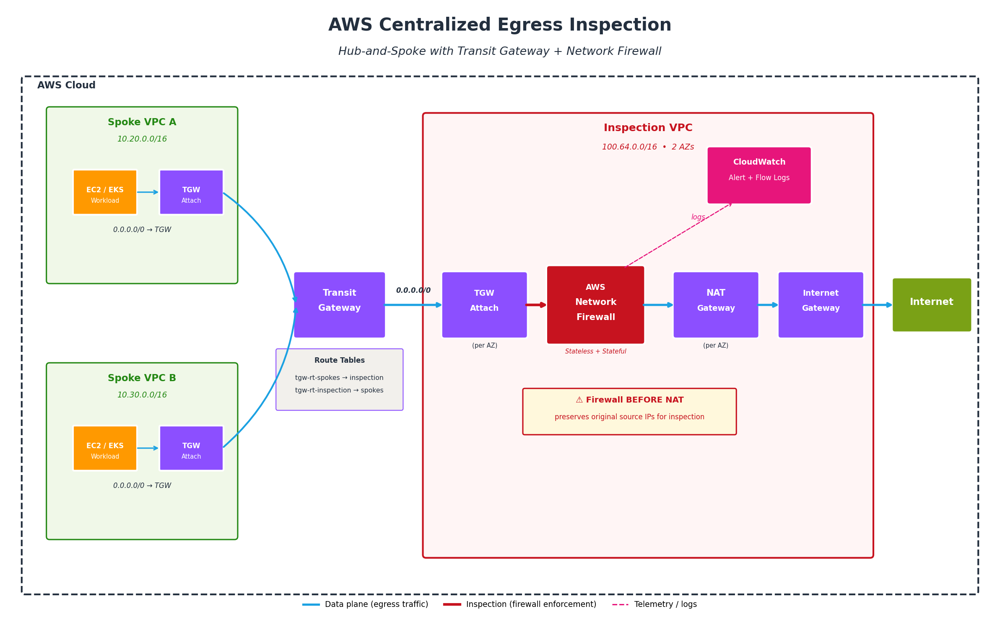

# AWS Centralized Egress Inspection with Network Firewall

[](https://www.terraform.io/)
[](https://aws.amazon.com/network-firewall/)
[](https://www.checkov.io/)
[](https://aquasecurity.github.io/tfsec/)
[](LICENSE)
[](https://aws.amazon.com/architecture/well-architected/)

> Production-grade reference architecture for centralized, policy-driven egress traffic inspection on AWS using Transit Gateway, Network Firewall, and a hub-and-spoke topology — with a hard focus on real-world operational behavior, not just theory.

---

## TL;DR

This repository deploys a **centralized egress inspection** architecture on AWS that forces every byte of internet-bound traffic from every workload VPC through a single inspection VPC running **AWS Network Firewall**, before it ever reaches a NAT Gateway. The result is a **default-deny-unless-inspected** posture, deterministic Suricata-based filtering, and unified visibility across a multi-account environment.

It also documents the things that don't make it into vendor diagrams: QUIC bypass, TLS inspection edge cases, certificate pinning failures, and asymmetric routing traps.

---

## Table of Contents

- [Why This Architecture](#why-this-architecture)
- [Architecture](#architecture)
- [What You'll Learn](#what-youll-learn)
- [Repository Structure](#repository-structure)
- [Prerequisites](#prerequisites)
- [Deployment](#deployment)
- [Validation](#validation)
- [Key Design Decisions](#key-design-decisions)
- [Operational Realities](#operational-realities)
- [Cost Estimate](#cost-estimate)
- [Cleanup](#cleanup)
- [References](#references)
- [License](#license)

---

## Why This Architecture

In multi-account AWS environments, egress traffic control tends to fragment: each VPC ends up with its own NAT Gateway, its own (inconsistent) security group rules, and no unified inspection point. This makes it nearly impossible to:

- Enforce consistent outbound policies across accounts
- Detect and block C2 callbacks, data exfiltration, or shadow-IT SaaS usage
- Produce reliable evidence for auditors (PCI-DSS 1.2/1.3, HIPAA, ISO 27001 A.13)
- Investigate incidents without stitching together logs from 30+ NAT Gateways

A centralized inspection VPC, fronted by AWS Network Firewall and aggregated via Transit Gateway, collapses all of that into a **single, observable enforcement point**.

---

## Architecture



> 📐 The editable diagram source is in [`diagrams/architecture.drawio`](diagrams/architecture.drawio). Open it in [draw.io](https://app.diagrams.net/) or VS Code with the Draw.io Integration extension.

### Traffic Flow

```
┌─────────────────┐     ┌─────────────────┐     ┌─────────────────┐
│  Spoke VPC A    │     │  Spoke VPC B    │     │  Spoke VPC N    │
│  (Workloads)    │     │  (Workloads)    │     │  (Workloads)    │
└────────┬────────┘     └────────┬────────┘     └────────┬────────┘
         │                       │                       │
         └───────────────┬───────┴───────────────────────┘
                         │  0.0.0.0/0 → TGW
                         ▼
                ┌─────────────────────┐
                │  Transit Gateway    │
                │  (Spoke RT → Insp)  │
                └──────────┬──────────┘
                           │
                           ▼
            ┌──────────────────────────────┐
            │     Inspection VPC           │
            │  ┌────────────────────────┐  │
            │  │  Firewall Subnets      │  │
            │  │  (NFW Endpoints / AZ)  │  │
            │  └───────────┬────────────┘  │
            │              │ inspected     │
            │              ▼               │
            │  ┌────────────────────────┐  │
            │  │  NAT Gateways / AZ     │  │
            │  └───────────┬────────────┘  │
            │              ▼               │
            │       Internet Gateway       │
            └──────────────┬───────────────┘
                           ▼
                       Internet
```

The critical ordering — **TGW → Firewall → NAT → IGW** — preserves original source IPs at the inspection layer. Reversing the order (NAT first) would source-NAT all spoke traffic to the inspection VPC's NAT IPs, blinding the firewall to which workload originated which flow.

---

## What You'll Learn

By deploying and studying this repo, you'll get hands-on with:

- ✅ Hub-and-spoke network design with Transit Gateway route table separation
- ✅ AWS Network Firewall stateless vs. stateful rule groups, and when each fires
- ✅ Suricata rule writing for AWS-managed firewall (with the AWS-specific gotchas)
- ✅ TLS SNI / HTTP Host filtering for domain-based egress control
- ✅ Why and how to block QUIC (UDP/443) to prevent inspection bypass
- ✅ Multi-AZ design that avoids asymmetric routing
- ✅ TLS inspection setup with ACM, and where it breaks in the real world
- ✅ Centralized logging across NFW, VPC Flow Logs, and TGW Flow Logs
- ✅ DevSecOps pipeline with Checkov, tfsec, and TFLint

---

## Repository Structure

```
.
├── README.md                      # You are here
├── ARCHITECTURE.md                # Deep technical design doc
├── SECURITY.md                    # Responsible disclosure policy
├── CONTRIBUTING.md                # Contribution guide
├── LICENSE                        # MIT
├── .pre-commit-config.yaml        # tf fmt, validate, gitleaks, checkov
├── .github/workflows/             # CI: plan, security scan, lint
├── diagrams/                      # draw.io sources + exported PNG/SVG
│   ├── architecture.drawio
├── terraform/
│   ├── main.tf                    # Root composition
│   ├── variables.tf
│   ├── outputs.tf
│   ├── versions.tf
│   ├── providers.tf
│   ├── terraform.tfvars.example
│   └── modules/
│       ├── transit-gateway/       # TGW + route tables + attachments
│       ├── inspection-vpc/        # Inspection VPC + NAT + IGW
│       ├── network-firewall/      # NFW + policy + rule groups
│       └── spoke-vpc/             # Reusable spoke
├── policies/
│   ├── stateless/                 # 5-tuple drop rules (e.g., QUIC)
│   └── suricata-rules/            # Domain allowlists, deny rules, custom sigs
├── scripts/
│   ├── deploy.sh                  # Wrapper for tf init/plan/apply
│   ├── test-egress.sh             # Validation from a spoke instance
│   └── trigger-detection.sh       # Generate test traffic for IR drills
└── tests/                         # Terratest validation
```

---

## Prerequisites

| Requirement     | Version   | Notes                                         |
|-----------------|-----------|-----------------------------------------------|
| Terraform       | ≥ 1.6.0   | Tested on 1.7.x                               |
| AWS Provider    | ≥ 5.30    | Required for current NFW resources            |
| AWS CLI         | ≥ 2.13    | For validation scripts                        |
| AWS Account     | —         | Permissions to create VPC, TGW, NFW, IAM, KMS |
| Region          | —         | Any region where Network Firewall is GA       |

> ⚠️ **Cost warning:** AWS Network Firewall and Transit Gateway both bill hourly per endpoint/attachment plus data processing. See [Cost Estimate](#cost-estimate) before applying.

---

## Deployment

```bash
# 1. Clone and enter
git clone https://github.com/iamemirozturk/aws-centralized-egress-inspection.git
cd aws-centralized-egress-inspection/terraform

# 2. Configure variables
cp terraform.tfvars.example terraform.tfvars
$EDITOR terraform.tfvars

# 3. Initialize and review the plan
terraform init
terraform plan -out=tfplan

# 4. Apply
terraform apply tfplan
```

Or use the wrapper:

```bash
./scripts/deploy.sh
```

The deployment provisions, in order:
1. Inspection VPC with firewall, NAT, and TGW-attachment subnets across 2 AZs
2. Transit Gateway with two route tables: `tgw-rt-spokes` and `tgw-rt-inspection`
3. AWS Network Firewall with policy, stateless & stateful rule groups
4. Two demo spoke VPCs attached to the spoke route table
5. Route table programming on every VPC and TGW route table to force the path

Expected apply time: **8–12 minutes** (NFW endpoints take the longest).

---

## Validation

From an EC2 instance launched into a spoke VPC private subnet (use SSM Session Manager — no public IPs needed):

```bash
# Should succeed (allowlisted)
curl -I https://aws.amazon.com

# Should be blocked by Suricata stateful rule
curl -I https://malware-test.example

# Should be blocked by stateless rule (QUIC drop)
nc -u -z 8.8.8.8 443

# Inspect logs
aws logs tail /aws/network-firewall/alert --follow
aws logs tail /aws/network-firewall/flow --follow
```

Sample expected log entry on a denied flow:

```json
{
  "firewall_name": "egress-inspection-fw",
  "event": {
    "alert": {
      "action": "blocked",
      "signature": "Block known-bad TLD",
      "category": "Egress Policy"
    },
    "tls": { "sni": "malware-test.example" }
  }
}
```

---

## Key Design Decisions

### 1. Firewall *before* NAT

Most "centralized inspection" diagrams get this right, but explaining *why* matters:

- **Source-IP visibility:** NFW sees `10.20.1.42` (the actual workload), not the NAT Gateway's EIP.
- **Per-spoke policy:** Stateful rules can match on private CIDRs, enabling per-application or per-account allowlists.
- **Forensics:** A SOC analyst correlating NFW alerts with VPC Flow Logs in the spoke can pivot on a single IP.

### 2. Strict rule order (not "default")

NFW's `STATEFUL_RULE_OPTIONS` defaults to `DEFAULT_ACTION_ORDER`, which evaluates rules by Suricata's signature ordering — meaning a missed `pass` action can silently allow traffic. This repo uses `STRICT_ORDER`, where the first match wins, top-to-bottom, deterministically. This is the AWS-recommended posture for production egress filtering.

### 3. Two TGW route tables (spokes ↔ inspection)

A single TGW route table allows spoke-to-spoke traffic by default — bypassing the firewall entirely for east-west flows. Splitting into:
- `tgw-rt-spokes` — propagates **only** the inspection VPC route
- `tgw-rt-inspection` — propagates all spoke routes

…forces every flow to traverse the inspection VPC, including any future east-west requirement.

### 4. Multi-AZ with AZ-affine routing

Each AZ has its own NFW endpoint, NAT GW, and TGW attachment ENI. Spoke VPC route tables are AZ-pinned to their local firewall endpoint to **prevent asymmetric routing** — a flow that egresses through AZ-A's firewall must return through AZ-A's firewall, otherwise the stateful engine drops it.

### 5. QUIC blocking

QUIC over UDP/443 encrypts the SNI and bypasses TLS-layer inspection entirely. Without an explicit drop rule, a Chrome client will silently switch to QUIC and exfiltrate to allowlisted-by-mistake domains. The stateless rule group in this repo drops UDP/443 for all egress flows.

---

## Operational Realities

This is the section vendor whitepapers omit. Lessons from running this in production:

| Challenge | Symptom | Mitigation |
|-----------|---------|------------|
| **Certificate pinning** | Mobile apps, banking SaaS, some Microsoft services break under TLS inspection | Maintain a TLS-inspection bypass list; document scope explicitly |
| **SaaS endpoint sprawl** | A single SaaS may resolve to 200+ FQDNs across CDNs | Prefer published service endpoint lists (e.g., Microsoft 365 IP ranges) |
| **Asymmetric routing** | Intermittent connection resets, especially during AZ failover | AZ-affine routing + same-AZ NAT placement |
| **NFW rule limits** | 10K stateful rules / policy hard limit | Tier policies: managed rule groups for breadth, custom for depth |
| **Logging cost** | NFW flow logs at ~$0.50/GB ingested can dominate the bill | Sample flow logs; keep alert logs at full fidelity |
| **TLS inspection latency** | +5–15ms per connection | Reserve for high-risk egress paths only |

See [`ARCHITECTURE.md`](ARCHITECTURE.md) for the full discussion.

---

## Cost Estimate

Rough monthly cost in `eu-west-1` for a 2-AZ deployment with 2 spoke VPCs and ~100 GB/day egress:

| Component | Monthly (USD, approx.) |
|-----------|------------------------|
| Network Firewall endpoints (2 AZ) | ~$580 |
| NFW data processing (3 TB) | ~$195 |
| Transit Gateway attachments (3) | ~$80 |
| TGW data processing | ~$60 |
| NAT Gateways (2 AZ) | ~$65 |
| NAT data processing | ~$135 |
| CloudWatch Logs ingest | ~$50 |
| **Total** | **~$1,165** |

> Always validate with the [AWS Pricing Calculator](https://calculator.aws/) for your specific region and traffic volume.

---

## Cleanup

```bash
cd terraform
terraform destroy
```

Or:

```bash
./scripts/destroy.sh
```

> ⚠️ Network Firewall logging configurations and CloudWatch log groups may need manual deletion if `prevent_destroy` lifecycle rules were enabled.

---

## References

- [AWS Network Firewall — Best practices](https://docs.aws.amazon.com/network-firewall/latest/developerguide/firewall-best-practices.html)
- [Deployment models for AWS Network Firewall (AWS blog)](https://aws.amazon.com/blogs/networking-and-content-delivery/deployment-models-for-aws-network-firewall/)
- [AWS Well-Architected — Security Pillar (Infrastructure Protection)](https://docs.aws.amazon.com/wellarchitected/latest/security-pillar/infrastructure-protection.html)
- [Suricata Rule Writing](https://suricata.readthedocs.io/en/latest/rules/index.html)
- [Centralized egress inspection — AWS Reference Architecture](https://aws.amazon.com/architecture/networking-content-delivery/)

---

## License

MIT — see [LICENSE](LICENSE).

## Author

Built as part of an AWS security architecture portfolio. Feedback and PRs welcome.
